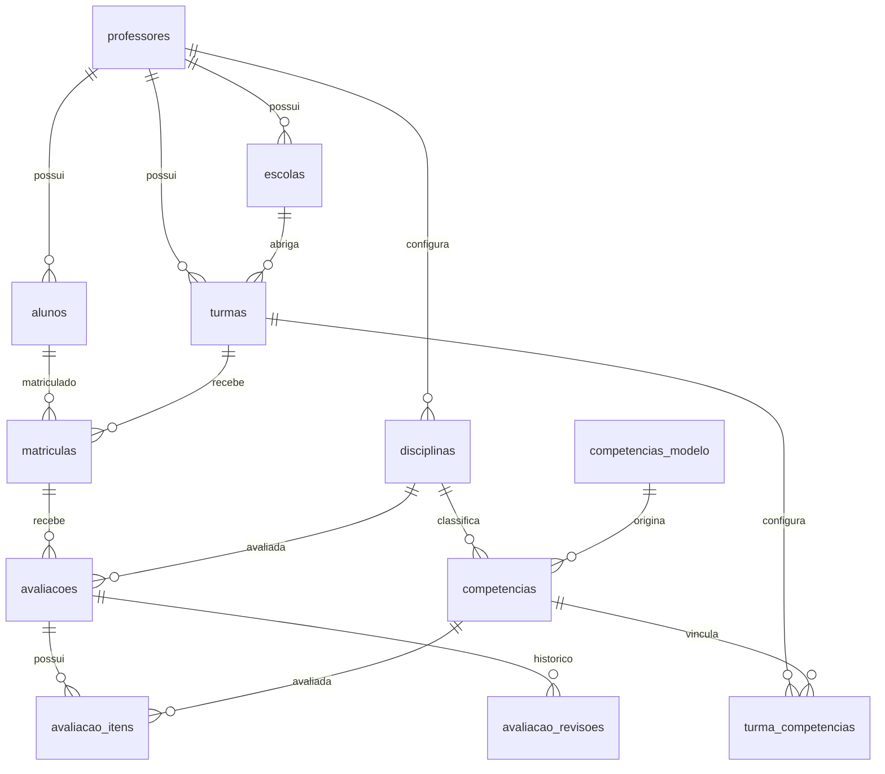

# Portal do Professor — Arquitetura, dados e funções

**Revisão:** 18/11/2026. Documentação derivada dos arquivos TSX/TS e das migrações SQL disponíveis na branch `main`. Isto é um inventário do código, **não** um dump do esquema vivo do Supabase.

## 1. Arquitetura

- **Frontend:** Next.js 15 (App Router), React 19, TypeScript, CSS global em `src/app/globals.css`.
- **Autenticação e persistência:** Supabase Auth + PostgreSQL + Row Level Security (RLS), via `@supabase/supabase-js`.
- **Cliente:** `src/lib/supabase.ts` expõe `getSupabase()`, inicializa um singleton com `NEXT_PUBLIC_SUPABASE_URL` e `NEXT_PUBLIC_SUPABASE_PUBLISHABLE_KEY`, PKCE, sessão persistente, atualização automática de tokens.
- **Proteção de telas:** `src/components/ProfessorShell.tsx` consulta `auth.getUser()`, acompanha sessão por `onAuthStateChange`, redireciona usuários sem sessão para `/login`, constrói o menu e oferece `signOut()`.
- **Operações:** páginas são componentes client-side; a maioria das leituras e cadastros usa PostgREST com filtros por `professor_id=user.id`. O banco deve reforçar propriedade por RLS. Avaliações usam funções RPC transacionais.
- **Hospedagem:** implantação Vercel conectada ao GitHub `sgobaixadasantista-web/portal-prof`, branch `main`.

## 2. Diretórios e arquivos principais

| Caminho | Responsabilidade |
|---|---|
| `src/app/layout.tsx` | HTML pt-BR, metadados e CSS global |
| `src/components/AuthForm.tsx` | Formulário de login/cadastro/recuperação, Google OAuth |
| `src/components/ProfessorShell.tsx` | Sessão autenticada, menu e logout |
| `src/lib/supabase.ts` | Construção de cliente Supabase |
| `src/app/dashboard/page.tsx` | Página inicial e atalhos |
| `src/app/escolas/page.tsx` | CRUD de escolas |
| `src/app/turmas/page.tsx` | CRUD e duplicação de turmas |
| `src/app/alunos/page.tsx` | Cadastro, importação e matrícula |
| `src/app/competencias/page.tsx` | Biblioteca, competências e pesos |
| `src/app/avaliacoes/page.tsx` | Avaliação individual, grade, reabertura e auditoria |
| `src/app/relatorios/page.tsx` | Relatórios, filtros, indicadores e exportações |
| `sql/auditoria_motor_v06.sql` | Consultas de auditoria somente leitura |
| `sql/migracao_motor_v06.sql` | Índice único, RPC de salvamento, proteção e view |
| `sql/migracao_motor_v061_revisoes.sql` | Reabertura com snapshots, auditoria e gatilho de encerramento |

## 3. Modelo lógico de dados



| Tabela / view | Papel e dados notáveis |
|---|---|
| `auth.users` | Identidade gerida pelo Supabase Auth |
| `professores` | Cadastro privado vinculado à identidade Auth |
| `escolas` | Escolas individuais, com `professor_id` |
| `turmas` | Escola, série, ano letivo, turno, periodicidade, dono |
| `alunos` | Nome do aluno, dono; sem outros dados pessoais no cadastro da V1 |
| `matriculas` | Vínculo aluno↔turma e indicador `ativo` |
| `disciplinas` | Disciplinas por professor |
| `competencias_modelo` | Biblioteca global com disciplina, ano, título, descrição e código BNCC quando disponível |
| `competencias` | Competências individuais, nome, descrição, disciplina, ano, modelo opcional, `ativa` |
| `turma_competencias` | Competência por turma, `peso`, `ativa` |
| `avaliacoes` | Matrícula, disciplina, período, data, observações, status, dono |
| `avaliacao_itens` | Conceito, peso aplicado e nome da competência congelados no lançamento |
| `avaliacao_revisoes` | Autor, motivo, datas e JSON snapshots anterior/posterior |
| `motor_v06_indicadores` (view) | Indicador arredondado, número de critérios avaliados e totais por avaliação |

**Relações/constraints observadas no resultado de auditoria do Supabase:** `avaliacao_itens` tem unicidade por `(avaliacao_id,competencia_id)`; FKs compostas amarram professor e avaliação/competência; `avaliacoes` possui restrições de status e período. `sql/migracao_motor_v06.sql` adiciona índice único por `(professor_id,matricula_id,disciplina_id,periodo_rotulo)`.

## 4. Funções de frontend por módulo

| Arquivo | Função principal / auxiliares | Descrição |
|---|---|---|
| `src/lib/supabase.ts` | `getSupabase` | Cria/reutiliza cliente Supabase com autenticação |
| `src/components/AuthForm.tsx` | `AuthForm`, `submit`, `google` | Login, registro, recuperação e OAuth |
| `src/components/ProfessorShell.tsx` | `ProfessorShell` | Proteção da UI por sessão e menu |
| `src/app/escolas/page.tsx` | `ListaEscolas`, `carregar`, `salvar`, `excluir` | Carrega registros privados, faz INSERT/UPDATE/DELETE |
| `src/app/turmas/page.tsx` | `CadastroTurmas`, `carregar`, `editar`, `salvar`, `duplicar`, `excluir` | CRUD, validação local, cópia de competências |
| `src/app/alunos/page.tsx` | `CadastroAlunos`, `lerExcel`, `cadastrar`, `salvarNome`, `alternarAtivo` | Importação, matrícula, correção e ativação |
| `src/app/competencias/page.tsx` | `Configurador`, `salvarDisciplina`, `inserirPadrao`, `importarModelo`, `novaCompetencia`, `alternarVinculo`, `atualizarPeso`, `salvarEdicao` | Biblioteca, disciplinas, competências próprias e pesos |
| `src/app/avaliacoes/page.tsx` | `Tela`, `estadoDe`, `editar`, `salvar`, `reabrir`, `indicadorDe`, `historico`, `celula` | Controle da avaliação, cálculo de prévia, RPC e histórico |
| `src/app/relatorios/page.tsx` | `Relatorios`, `carregar`, `exportarCsv`, `criterioPeriodo`, `excel`, `imprimir` | Carrega avaliações concluídas, filtra, organiza, imprime/exporta |

A prévia local de indicador da tela de avaliações está em `indicadores(...)` e utiliza os mesmos valores de conceitos; o valor persistido para relatórios é produzido pela view SQL.

## 5. Funções e controles do banco

### 5.1 V0.6 — `sql/migracao_motor_v06.sql`

- `motor_v06_salvar_avaliacao(p_matricula_id uuid, p_disciplina_id uuid, p_periodo_rotulo text, p_data_avaliacao date, p_observacoes text, p_itens jsonb, p_concluir boolean)` → **retorna UUID da avaliação**. Usa `auth.uid()`, verifica matrícula ativa, professor/disciplina, competências ativas e seus pesos, rejeita duplicidade de itens e exige ao menos um item avaliado com peso positivo para conclusão. Dentro de uma transação do PostgreSQL cria/atualiza cabeçalho, substitui itens do rascunho e conclui quando solicitado. Chamada pelo `salvar` da tela Avaliações.
- `motor_v06_proteger_avaliacao()` → trigger em `avaliacoes`; impede inserção direta já concluída, exclusão de concluída e alterações não autorizadas em concluídas. A versão V0.6.1 substitui sua definição para liberar apenas a transição auditada.
- `motor_v06_proteger_item()` → trigger em `avaliacao_itens`; bloqueia edição dos itens quando a avaliação está concluída.
- `motor_v06_indicadores` → view com `security_invoker = true`, para respeitar RLS do usuário; retorna total e quantidade avaliada, além do indicador arredondado a uma casa.
- Índice `avaliacoes_unica_matricula_disciplina_periodo` → impede duplicação de cabeçalhos por professor/matrícula/disciplina/período.

### 5.2 V0.6.1 — `sql/migracao_motor_v061_revisoes.sql`

- `avaliacao_revisoes`: um registro por reabertura; armazena `avaliacao_id`, `professor_id`, `autor_id`, `motivo`, `reaberta_em`, `encerrada_em`, `encerrada_por`, `snapshot_antes`, `snapshot_depois`. Índice parcial impede mais de uma revisão aberta por avaliação.
- `motor_v061_reabrir_avaliacao(p_avaliacao_id uuid, p_motivo text)` → RPC que verifica `auth.uid()`, propriedade e status concluído; exige motivo 10–1000 caracteres; grava snapshot e reabre em um único fluxo. É `SECURITY DEFINER`, com checagem explícita de autorização.
- `motor_v061_encerrar_revisao()` → trigger depois da transição de rascunho para concluída; grava snapshot posterior e autor da nova conclusão.
- Política em `avaliacao_revisoes`: **leitura apenas pelo professor dono**, sem INSERT/UPDATE/DELETE concedidos ao cliente autenticado.
- Reabertura guarda versões dentro de JSON, mas a versão corrente permanece nas tabelas `avaliacoes`/`avaliacao_itens`.

### 5.3 Exemplo de payload da RPC de salvamento

```typescript
const {data: avaliacaoId, error} = await getSupabase().rpc(
  "motor_v06_salvar_avaliacao",
  {
    p_matricula_id: matriculaId,
    p_disciplina_id: disciplinaId,
    p_periodo_rotulo: "1º Bimestre / 2026",
    p_data_avaliacao: "2026-11-18",
    p_observacoes: "Acompanhamento pedagógico",
    p_itens: [
      {competencia_id: competenciaId1, conceito: "bom"},
      {competencia_id: competenciaId2, conceito: "regular"}
    ],
    p_concluir: false
  }
);
```

`p_itens` deve conter **todas as competências ativas** daquele conjunto (turma + disciplina), não somente as que receberam conceito.

## 6. Autorização e isolamento

1. A autenticação usa Supabase Auth; dados próprios usam `professor_id` igual ao UUID de `auth.uid()`.
2. Na auditoria enviada pelo usuário, `avaliacoes` e `avaliacao_itens` tinham políticas RLS para SELECT, INSERT, UPDATE e DELETE, restringindo a `professor_id = auth.uid()`.
3. A view de indicadores é `security_invoker`, preservando restrições de leitura por proprietário.
4. `avaliacao_revisoes` tem RLS e SELECT apenas do dono; escrita direta não é disponibilizada ao usuário.
5. `motor_v061_reabrir_avaliacao` é função privilegiada e valida `auth.uid()` contra o dono **antes** de alterar estado. Necessita testes de penetração/negação entre duas contas.
6. O usuário testou uma segunda conta e não visualizou os registros da primeira na interface; isso **não comprova sozinho** todas as policies de todo o banco.
7. Não usar chaves `service_role` no frontend, não permitir edição manual de `professor_id` pela interface e não adicionar colaboração na V1.

## 7. Operação, configuração e migrações

```bash
npm install
npm run dev
npm run build
```

Variáveis públicas do frontend:

```env
NEXT_PUBLIC_SUPABASE_URL=https://SEU-PROJETO.supabase.co
NEXT_PUBLIC_SUPABASE_PUBLISHABLE_KEY=CHAVE_PUBLICAVEL
```

Não colocar credenciais reais em arquivos versionados.

Ordem de manutenção do motor: auditoria `sql/auditoria_motor_v06.sql` (read-only) → V0.6 `sql/migracao_motor_v06.sql` → V0.6.1 `sql/migracao_motor_v061_revisoes.sql`. Essas migrações foram executadas no SQL Editor pelo usuário, fora do pipeline automático do Vercel. As alterações do código **não** executam SQL automaticamente no Supabase.

## 8. Notas de engenharia e limitações

- Muitos cadastros utilizam várias requisições sequenciais. Avaliação (V0.6) é transacional; importação de alunos, duplicação de turmas e algumas operações de competências **não** têm atomicidade integral.
- Relatório V0.7 carrega dados filtrados pelo professor no navegador e calcula a média das avaliações listadas. Para conjuntos muito grandes, rever paginação, filtros de servidor e limitações de retorno do PostgREST.
- A contagem de alunos distintos no relatório é construída por nome+turma; dois estudantes homônimos na mesma turma podem ser contados como um. Recomenda-se alterar para matrícula/ID antes de uso em larga escala.
- A evolução considera período e comparação dentro do mesmo aluno, turma e disciplina; a ordenação deve ser testada com anos e periodicidades diferentes.
- Não há evidência de testes automatizados end-to-end em CI nesta inspeção; a homologação relatada foi manual.
- **Não tratar `READY` da Vercel como prova de que SQL e RLS estão corretos**; builds verificam compilação, não autorização real.
