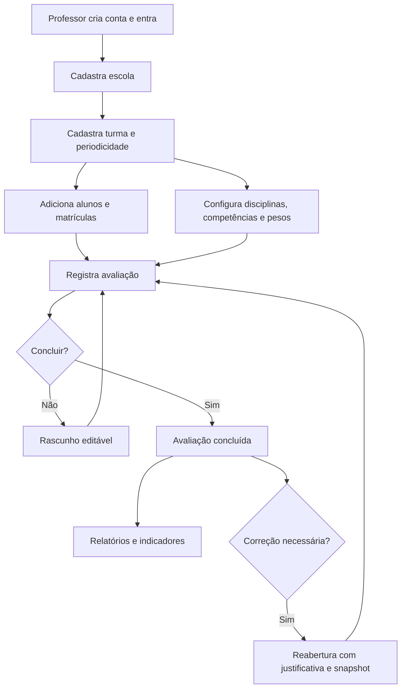

# Portal do Professor — Manual funcional e catálogo de páginas

**Revisão:** 18/11/2026 · **Escopo:** V1 em desenvolvimento, com motor V0.6/V0.6.1 e relatórios V0.7.
**Fonte:** código de `src/app`, `src/components` e `src/lib`, branch `main`, consultado em 18/11/2026.

## 1. Finalidade e público

Aplicação web para acompanhamento pedagógico individual de professores do Ensino Fundamental I (1º ao 5º ano). Permite criar escolas e turmas, cadastrar alunos apenas pelo nome, configurar competências e pesos, registrar avaliações com conceitos, revisar avaliações concluídas com auditoria e emitir relatórios. **Não há compartilhamento de cadastros e notas entre professores na V1**. A biblioteca global de modelos de competências é a exceção: pode ser consultada por todos e importada para a área privativa.

## 2. Mapa de navegação

| Rota | Página | Função | Situação observada no código |
|---|---|---|---|
| `/login` | Entrar | Autenticação por e-mail/senha ou Google | Implementada |
| `/cadastro` | Criar acesso | Registro de conta com nome, e-mail e senha | Implementada |
| `/recuperar-senha` | Recuperar acesso | Envio de link por e-mail | Implementada |
| `/auth/callback` | Retorno OAuth | Processar retorno da autenticação | Rota prevista no fluxo; verificar arquivo da rota |
| `/auth/atualizar-senha` | Atualização de senha | Destino do link de recuperação | Destino referenciado pelo formulário; verificar arquivo da rota |
| `/dashboard` | Início | Boas-vindas e atalhos dos módulos | Implementada; não é dashboard analítico |
| `/escolas` | Escolas | Cadastro, edição, exclusão e listagem | Implementada |
| `/turmas` | Turmas | Cadastro, filtros, edição, duplicação e exclusão condicionada | Implementada |
| `/alunos` | Alunos | Cadastro individual, lista colada, Excel, edição e ativação da matrícula | Implementada |
| `/competencias` | Disciplinas e competências | Biblioteca, modelos, personalizações, vínculo com turma, pesos | Implementada |
| `/avaliacoes` | Avaliações pedagógicas | Ficha individual, grade, rascunho, conclusão e auditoria | Implementada; homologação funcional relatada |
| `/relatorios` | Relatórios e indicadores | Fichas, tabela da turma e evolução; CSV e impressão | Implementada; homologação parcial |

A navegação das páginas autenticadas é controlada por `ProfessorShell` e apresenta Dashboard, Escolas, Turmas, Alunos, Competências, Avaliações, Relatórios e Sair.

## 3. Guia operacional por tela

### 3.1 Login, cadastro e recuperação

- **Login:** informar e-mail e senha ou escolher Google. Após autenticação, acessar a área protegida.
- **Criar conta:** preencher nome, e-mail e senha; o formulário usa `supabase.auth.signUp` e envia o nome como metadado inicial.
- **Recuperação:** informar e-mail para receber link de redefinição.
- **Sair:** encerra a sessão via Supabase Auth e retorna à página de login.
- A sessão é persistente no navegador e renovada automaticamente pelo cliente Supabase.

### 3.2 Dashboard (`/dashboard`)

Exibe saudação com nome/metadados ou e-mail e seis cartões de navegação. **Não** apresenta ainda gráficos de desempenho, totais dinâmicos ou metas pedagógicas; o nome Dashboard indica a página de entrada.

### 3.3 Escolas (`/escolas`)

- Criar escola informando **nome**.
- Listar as escolas privadas da conta, em ordem alfabética.
- Editar o nome de uma escola existente.
- Excluir mediante confirmação. A exclusão pode ser recusada pelo banco caso existam vínculos.
- Não há cadastro compartilhado nem diretório institucional global.

### 3.4 Turmas (`/turmas`)

- Escolher uma escola cadastrada; definir **nome**, **ano letivo** (2000–2100), **ano escolar** (1º–5º), **turno** (manhã, tarde, integral ou noite) e **periodicidade da avaliação** (semanal, mensal, bimestral ou trimestral).
- Filtrar listagem por escola ou ano letivo.
- Editar dados e excluir turma sem matrículas. Turmas com matrículas são preservadas pela verificação da tela.
- **Duplicar para outro ano letivo:** cria nova turma com mesmos dados e copia os vínculos de competências com respectivos pesos e estado de ativação. **Não copia alunos, matrículas ou avaliações**.
- Observação técnica: duplicação executa mais de uma operação no cliente; uma falha ao copiar competências pode deixar a nova turma criada. A tela informa erro parcial.

### 3.5 Alunos (`/alunos`)

- Selecionar escola e turma.
- Três modalidades: **Individual** (um nome), **Lista** (colar diversos nomes) e **Excel** (importação de nomes via biblioteca `read-excel-file`).
- Cadastro pessoal mínimo: **nome**, separado do vínculo com a turma em `matriculas`.
- Normalização de espaços e comparação de nomes sem acentos para prevenção de repetições na turma.
- Listar, editar nome e ativar/desativar vínculo de matrícula; código limita o processamento de importação em lote a até 300 alunos.
- A desativação preserva o registro; não equivale a apagar histórico pedagógico.

### 3.6 Disciplinas e competências (`/competencias`)

- Registrar disciplinas próprias ou usar o comando **Adicionar disciplinas iniciais**.
- Consultar **modelos de competências** por ano escolar e disciplina (biblioteca global `competencias_modelo`).
- Importar modelo para `competencias` privadas do professor.
- Criar uma competência personalizada, vinculada à disciplina e à turma.
- Editar nome e descrição de competência própria.
- Ativar/desativar o vínculo em `turma_competencias`; informar **peso** por competência na turma, intervalo 0–100, com campo numérico em incrementos de 0,5.
- O painel informa a **soma dos pesos ativos**. Não há exigência no motor de que a soma seja exatamente 100: a média é normalizada pelos pesos válidos.
- Os pesos vigentes podem mudar, mas uma avaliação já concluída conserva `peso_aplicado` e `competencia_nome_snapshot` nos seus itens.

### 3.7 Avaliações (`/avaliacoes`)

1. Escolher turma, disciplina e período criado pela periodicidade da turma.
2. Alternar entre **Avaliação individual** e **Avaliação por turma** (grade).
3. Selecionar conceitos: **Não avaliado**, **Ruim**, **Regular**, **Bom**, **Ótimo**.
4. Preencher a data da avaliação e, na ficha individual, observações opcionais.
5. **Salvar rascunho:** estado editável e persistente. **Concluir avaliação:** exige ao menos uma competência avaliada com peso positivo.
6. Depois de concluída, a ficha e a grade bloqueiam edição comum; mudanças demandam reabertura auditada.
7. **Solicitar reabertura:** informar motivo de 10 a 1.000 caracteres; o banco salva snapshot anterior, muda para rascunho e registra autor/data.
8. Corrigir e concluir novamente: o banco salva snapshot posterior; a ficha apresenta histórico, motivo, datas, responsáveis e mudanças por competência.
9. A grade usa os mesmos registros da ficha, com botões de salvar/concluir por aluno e acesso à revisão na visualização individual.

**Identidade:** mesmo professor pode cadastrar escolas com nomes iguais aos de outro professor, mas os dados continuam separados. O UUID do usuário autenticado é a identidade de referência.

### 3.8 Relatórios (`/relatorios`)

- Trabalha **somente com avaliações `concluida`**; avaliações reabertas, ainda em rascunho, não aparecem.
- Abas: **Individual** (competência, conceito, peso histórico, observação e indicador); **Turma** (aluno, turma, disciplina, período, nota, quantidade de critérios); **Evolução** (nota por período e variação para o período anterior da mesma turma/aluno/disciplina).
- Filtros: escola, turma, disciplina, aluno e período (o período é omitido na aba Evolução).
- Resumo: quantidade de avaliações concluídas, alunos avaliados e **média simples dos indicadores mostrados**, sem ponderação entre disciplinas.
- Exportações: **CSV com BOM UTF-8 e separador ponto e vírgula**, aberto pelo Excel; **PDF por diálogo de impressão do navegador** (`window.print`), não geração server-side; não há `.xlsx` nativo.
- A tela usa a view `motor_v06_indicadores` para dados do resultado; a ficha individual lê os snapshots de `avaliacao_itens`.
- O relatório não apresenta versões antigas de avaliações reabertas; o histórico dessas versões é consultado em Avaliações.

## 4. Conceitos e cálculo

| Conceito | Valor |
|---|---:|
| Ruim | 2,5 |
| Regular | 5,0 |
| Bom | 7,5 |
| Ótimo | 10,0 |
| Não avaliado | Excluído do cálculo |

`Indicador = soma(nota_do_conceito × peso_aplicado) / soma(peso_aplicado das competências avaliadas com peso > 0)`.

O motor arredonda o indicador da view para **uma casa decimal**. Se nenhum conceito com peso positivo estiver avaliado, o indicador fica sem valor. A média geral dos relatórios representa a média simples dos indicadores de avaliação disponíveis e não um juízo pedagógico automatizado.

## 5. Fluxo resumido

## 6. Limites da versão

- V1 **individual por professor**: sem compartilhamento, equipe escolar, aprovação de terceiros ou perfil de gestor.
- Relatório PDF via impressão e Excel via CSV; formatação avançada de páginas A4 e `.xlsx` nativo ainda podem evoluir.
- Falta homologar os três tipos de relatório e seus arquivos exportados em diferentes navegadores e volumes de dados.
- Teste entre duas contas relatado pelo usuário comprovou **não visualização na interface**, mas não substitui teste adversarial de API/RLS.
- Para uso com dados reais: revisar retenção, backup, exclusão, consentimento/base legal e políticas de proteção de dados conforme contexto da instituição.

## 7. Referências

- [Catálogo técnico](./ARQUITETURA_E_FUNCOES.md)
- [Testes e pendências](./TESTES_E_PENDENCIAS.md)
- [Página de avaliações](../src/app/avaliacoes/page.tsx)
- [Página de relatórios](../src/app/relatorios/page.tsx)
